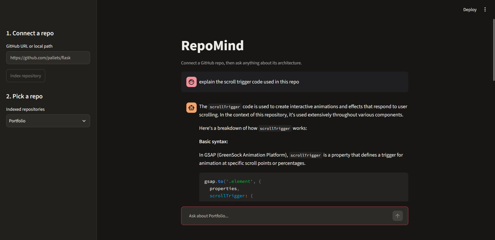

# RepoMind

Ask questions about a codebase in plain English. Connect a GitHub repo and RepoMind finds the relevant code and explains it, with file and line citations.

**Why:** when you join a large project, working out the architecture, APIs, dependencies and request flow takes days. RepoMind is a RAG (retrieval-augmented generation) system aimed at that first week.

Everything runs locally and for free: models run through [Ollama](https://ollama.com), so there is no API key.



## How it works

```
INDEXING (once per repo, then incremental)
 repo -> read files -> split into chunks -> embed -> ChromaDB
              |
              +-> static analysis -> dependency / API route / import-graph summaries -> ChromaDB

ASKING
 question -> (rewrite follow-ups) -> vector search + keyword search -> merge -> local LLM -> answer + sources
```

| Step | File | What it does |
|------|------|--------------|
| Load | `repomind/loader.py` | Clone with git (private repos via `GITHUB_TOKEN`), skip `node_modules`, lock files, binaries |
| Chunk | `repomind/chunker.py` | Split at function/class boundaries (Python via `ast`, other languages via regex, Markdown by heading) |
| Analyse | `repomind/analysis.py` | Extract dependencies, API routes and the internal import graph into overview documents |
| Embed + search | `repomind/store.py` | Ollama embeddings in ChromaDB, plus BM25 keyword search, merged with reciprocal rank fusion |
| Keyword index | `repomind/bm25.py` | Small BM25 implementation that understands `camelCase` and `snake_case` |
| Index | `repomind/indexer.py` | Hash-based incremental re-indexing |
| Answer | `repomind/qa.py` | Follow-up rewriting, chat history, prompt, streaming answer |

## Setup

Requires Python 3.10+, `git` and Ollama.

```bash
ollama pull llama3.2            # writes the answers (~2 GB)
ollama pull nomic-embed-text    # searches the code (~270 MB)

python -m venv .venv
source .venv/bin/activate       # Windows: .venv\Scripts\Activate.ps1
pip install -r requirements.txt
```

Low on RAM? `llama3.2` needs about 4 GB free. With 16 GB, `ollama pull qwen2.5-coder:7b` and `REPOMIND_MODEL=qwen2.5-coder:7b` (in a `.env` file) gives better code answers.

## Use it

```bash
streamlit run app.py
```

Paste a GitHub URL in the sidebar, click *Index repository*, then ask questions or use the quick-question buttons.

Command line:

```bash
python cli.py index https://github.com/pallets/flask
python cli.py ask pallets-flask "How does request routing work?"
python cli.py chat pallets-flask
python cli.py list
```

Repos are named `owner-repo` (local folders use the folder name).

Indexing the same repo again only re-embeds files that changed. `--full` (or the *Full re-index* checkbox) rebuilds everything.

Private repos: put `GITHUB_TOKEN=<personal access token>` in `.env`. The token is only sent to github.com and is not kept in the clone's git config.

## What it can answer

- "Give me an overview of the architecture." (uses the file tree, entry points and import graph)
- "What are the API endpoints and where are they defined?" (uses the detected routes)
- "What dependencies does this use?" (uses the parsed manifests)
- "Where is `UserController` used?" (exact names are found by keyword search)
- Follow-ups such as "and where is that configured?" (the question is rewritten using the chat history)

## Tests and evaluation

```bash
pip install -r requirements-dev.txt
python -m pytest
```

The tests run offline with a fake embedder.

To measure retrieval quality on a real repo, write a few questions with the files that should be found (see `eval_example.json`) and run:

```bash
python eval.py pallets-flask eval_example.json --k 6
```

It prints hit rate and MRR. Re-run it after changing chunk sizes, `TOP_K` or models to see whether the change helped.

## Limitations

- **Model quality.** A 3B model on CPU is slow and sometimes shallow or wrong. Check the Sources list under each answer.
- **Heuristic analysis.** Routes and imports are found with regexes and `ast`, not a full parser. Routes are detected for Flask/FastAPI, Django `urls.py`, Express, Next.js, Spring and Go. Import graphs cover Python and JS/TS only. Dynamic imports, aliases other than `@/` and `~/`, and metaprogrammed routes are missed.
- **Chunking.** Python is split precisely. Other languages split on top-level definitions only, so a large Java or C# class falls back to line windows.
- **No call graph.** It knows which files import which, not which function calls which.
- **Context limit.** Each question sees about 6-9 chunks. Questions that need many files at once ("list every place that touches X") will be partial.
- **Skipped files.** Files over 200 KB and binary files are ignored.
- **Chat history** lives in the browser session and is lost on refresh.

## Ideas for next steps

- Re-ranking: retrieve 30 chunks, have the LLM or a cross-encoder pick the best 6.
- tree-sitter for accurate parsing of every language.
- A function-level call graph.
- Hosting: swap Ollama for a hosted model API behind the same two functions in `qa.py` and `store.py`.

## Layout

```
app.py              Streamlit UI
cli.py              command line
eval.py             retrieval evaluation
eval_example.json   sample questions
repomind/           the library (config, loader, chunker, analysis, bm25, store, indexer, qa)
tests/              pytest suite
```
